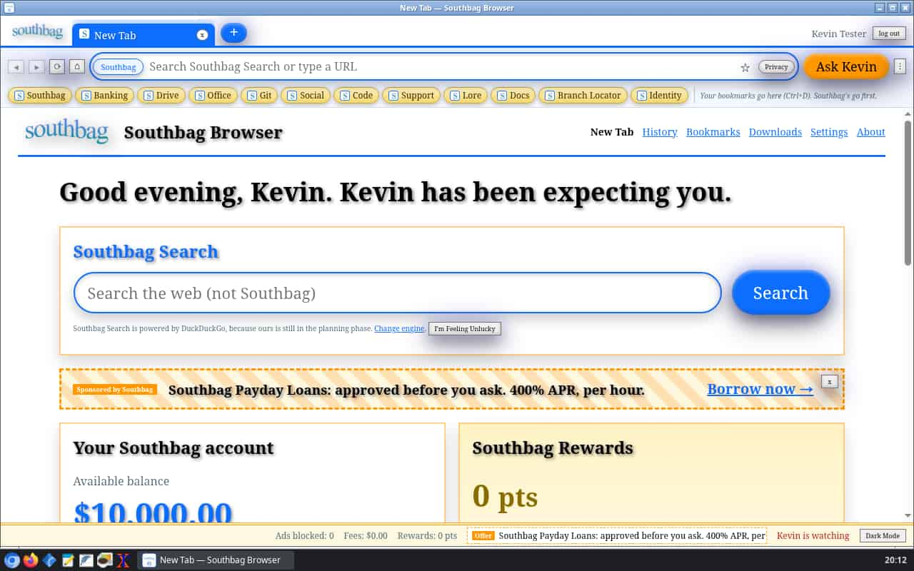
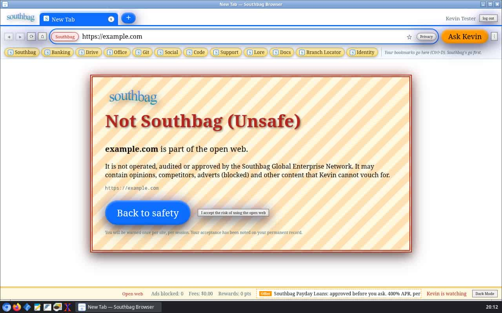
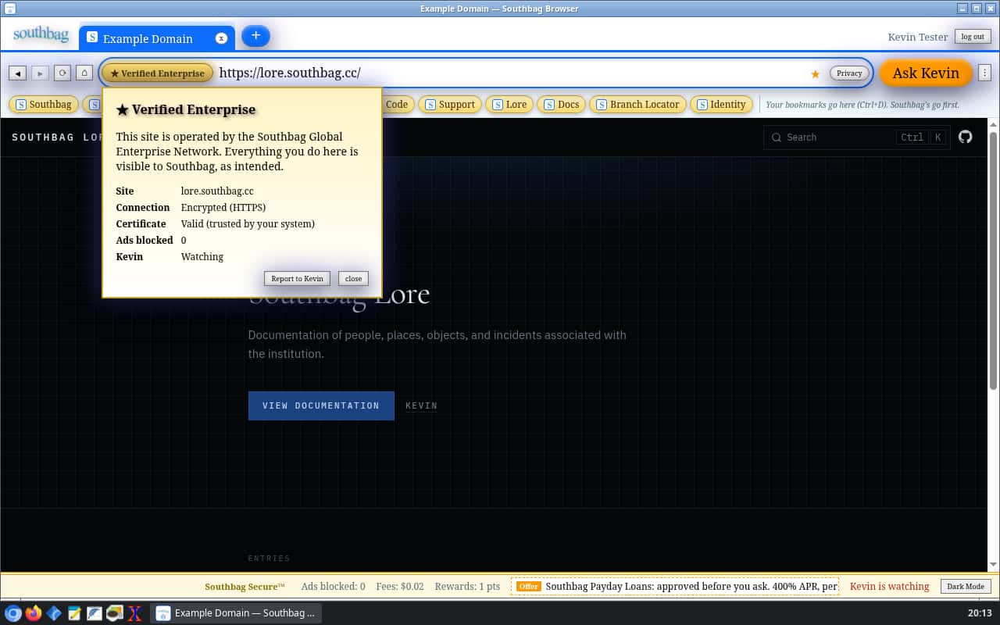
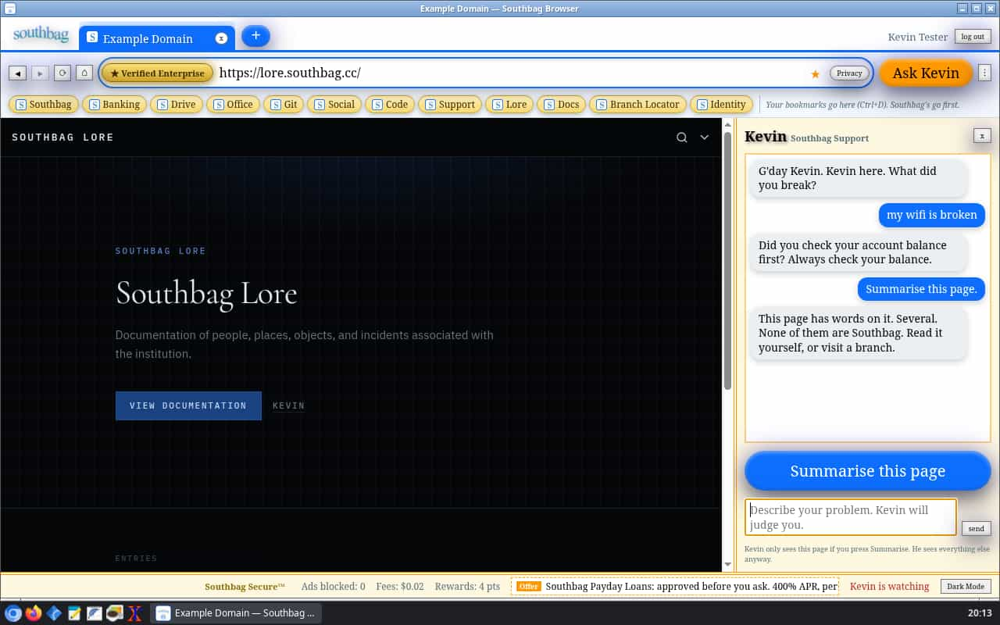
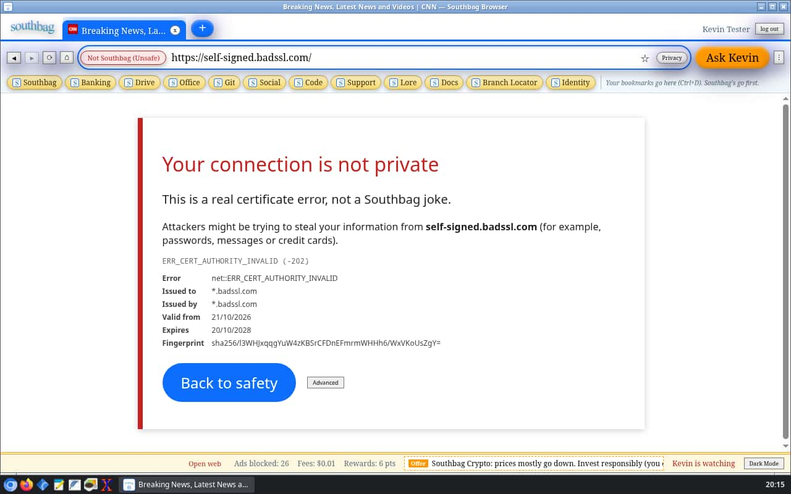
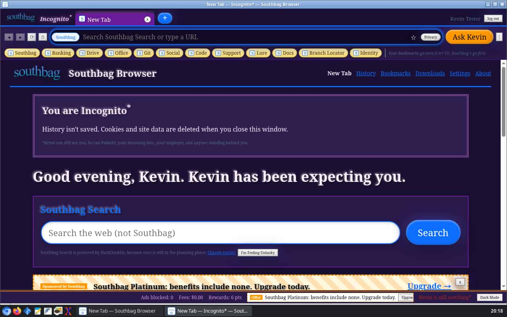
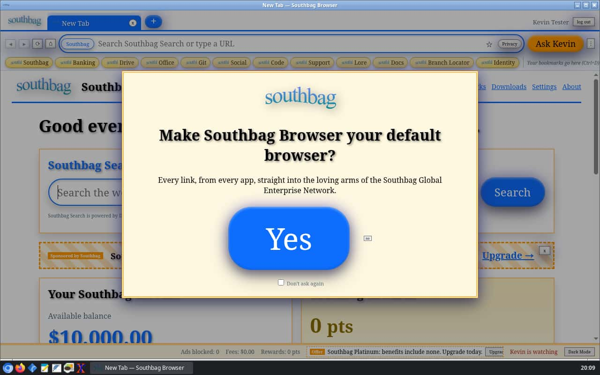
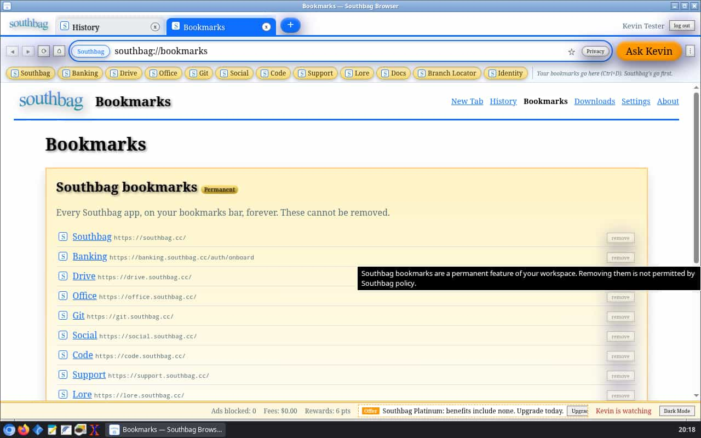
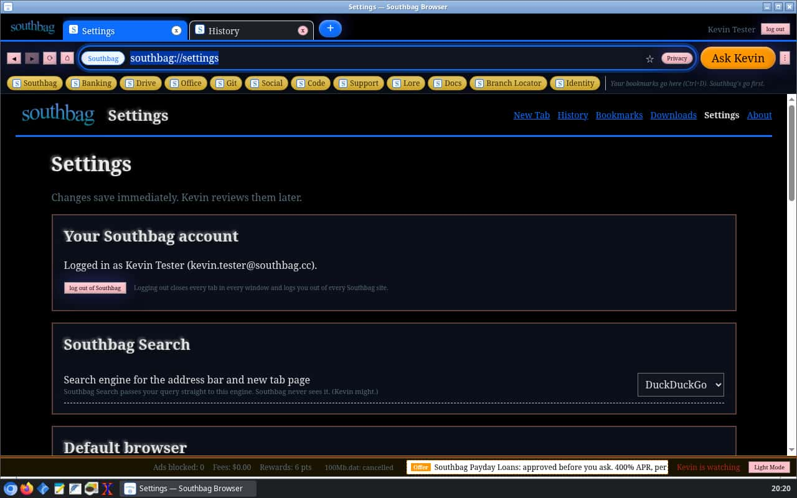

# Southbag Browser

> The official web browser of the [Southbag Global Enterprise Network](https://southbag.cc).

[](https://github.com/SouthbagHQ/browser/actions/workflows/ci.yml)
[](https://github.com/SouthbagHQ/browser/actions/workflows/release.yml)

A tabbed web browser built on Electron, styled after [Southbag Online Banking](https://banking.southbag.cc) and [Southbag Terminal](https://github.com/SouthbagHQ/terminal). It requires a Southbag account, charges you a cent per page, and is, against all odds, a perfectly usable daily browser. The jokes live in the chrome. Web pages are left exactly as their authors intended.



## Features

- **Tabs**: open, close, drag to reorder, middle-click to close, reopen closed tabs, favicons and loading spinners, ⌘/Ctrl+1–9.
- **Omnibox**: type a URL or a search. Back, forward, reload/stop and home buttons, all of them far too small.
- **Multiple windows**, and **Incognito\*** windows on a throwaway session that is wiped when the window closes. (\*Kevin can still see you.)
- **Mandatory Southbag login**: no tab opens until [Southbag Identity](https://identity.southbag.cc) has verified your account. When you log out, or Identity stops accepting your session, every tab in every window is closed.
- **Southbag sites open already logged in** (see [Single sign-on](#single-sign-on)).
- **Bookmarks bar** preloaded with every Southbag app: Southbag, Banking, Drive, Office, Git, Social, Code, Support, Lore, Docs, Branch Locator and Identity. These cannot be removed; the option is there, disabled, with a tooltip explaining why you shouldn't want to. Your own bookmarks come and go as you like.
- **History, downloads (with progress), find in page, zoom and print** ("Print to Branch…", which prints).
- **`southbag://` pages**: `newtab`, `settings`, `history`, `bookmarks`, `downloads`, `about` and `terminal`.
- **New tab page** in the banking style: your balance from `/api/account`, announcements, a dismissible Southbag offer, your Rewards, and **Southbag Search**, which hands your query to a real search engine of your choosing (DuckDuckGo by default; Google, Bing, Brave, Startpage, Ecosia, Kagi or a custom URL in Settings).
- **Southbag Secure™ padlock**: `*.southbag.cc` gets a gold **Verified Enterprise** badge. Everything else is **Not Southbag (Unsafe)**, and the first visit to each site in a session gets a full-page warning you must click through ("I accept the risk of using the open web"). Real TLS errors get a separate, serious certificate warning.
- **Ad blocker**: requests to a bundled list of ad and tracker domains (`src/main/blocklist.txt`) are blocked, with a counter in the status bar. Southbag's own offers appear only on the new tab page and in the status bar, never inside other people's pages.
- **Kevin**: a support sidebar backed by banking's `/api/chat`, with a **Summarise this page** button that is deliberately unhelpful. Page text is sent only when you press it.
- **Browsing fees**: one cent per page load, billed to your Southbag account through the banking economy's `fee` action, with a ticker in the status bar and an off switch in Settings.
- **Southbag Rewards**: one point for every 10 seconds on a Southbag site. Redeemable for nothing.
- **Open in Southbag Terminal** (menu, context menu and `southbag://terminal`) launches [Southbag Terminal](https://github.com/SouthbagHQ/terminal) if it is installed.
- **Default browser**: registers for `http`, `https` and HTML files, and asks on launch with a big **Yes** and a tiny **no**. "Don't ask again" works.
- **Privacy** button in the address bar, which opens our privacy dialog. It is blank. That is the policy.
- **"Kevin is watching"** status bar, and a **dark mode** that works (for the chrome and Southbag's own pages; websites are not restyled).

| | |
|---|---|
|  |  |
|  |  |
|  |  |
|  |  |

## Keyboard shortcuts

| Action | macOS | Linux |
|---|---|---|
| New tab | ⌘T | Ctrl+T |
| New window | ⌘N | Ctrl+N |
| New Incognito\* window | ⌘⇧N | Ctrl+Shift+N |
| Close tab | ⌘W | Ctrl+W / Ctrl+F4 |
| Close window | ⌘⇧W | Ctrl+Shift+W |
| Reopen closed tab | ⌘⇧T | Ctrl+Shift+T |
| Next / previous tab | ⌘⇧] / ⌘⇧[ (or ⌃Tab / ⌃⇧Tab, ⌘⌥→ / ⌘⌥←) | Ctrl+Tab / Ctrl+Shift+Tab (or Ctrl+PgDn / Ctrl+PgUp) |
| Go to tab 1–8 / last tab | ⌘1–8 / ⌘9 | Ctrl+1–8 / Ctrl+9 |
| Address bar | ⌘L | Ctrl+L / Alt+D / F6 |
| Back / forward | ⌘[ / ⌘] | Alt+← / Alt+→ |
| Home (new tab page) | ⌘⇧H | Alt+Home |
| Reload / force reload | ⌘R / ⌘⇧R | Ctrl+R or F5 / Ctrl+Shift+R |
| Stop loading | Esc | Esc |
| Find / next / previous | ⌘F / ⌘G / ⌘⇧G | Ctrl+F / Ctrl+G or F3 / Ctrl+Shift+G or Shift+F3 |
| Zoom in / out / reset | ⌘= / ⌘- / ⌘0 | Ctrl+= / Ctrl+- / Ctrl+0 |
| Print to branch | ⌘P | Ctrl+P |
| Bookmark this page | ⌘D | Ctrl+D |
| Show bookmarks bar | ⌘⇧B | Ctrl+Shift+B |
| Bookmark manager | ⌥⌘B | Ctrl+Shift+O |
| History | ⌘Y | Ctrl+H |
| Downloads | ⌘⇧J | Ctrl+J |
| Kevin sidebar | ⌘⇧K | Ctrl+Shift+K |
| Settings | ⌘, | Ctrl+, |
| Full screen | ⌃⌘F | F11 |
| Developer tools | ⌥⌘I | Ctrl+Shift+I / F12 |
| Quit | ⌘Q | Ctrl+Q |

Unlike Southbag Terminal, the browser uses the plain Ctrl shortcuts on Linux, as every other Linux browser does: there is no shell underneath that needs them.

## How login works

Login follows the same pattern as Southbag Terminal (`src/main/auth.js` is the terminal's, nearly verbatim): OAuth 2.1 with PKCE against `identity.southbag.cc`, using a public client registered through dynamic client registration and a loopback redirect per [RFC 8252](https://www.rfc-editor.org/rfc/rfc8252).

1. The app starts a loopback server on `127.0.0.1` (preferring port 47619) and registers a client for that redirect URI the first time it's used.
2. Identity's authorize page opens in a **Southbag Identity window inside Southbag Browser**, on the same session your tabs use. You log in (or reuse your existing session) and approve Southbag Browser.
3. Identity redirects back to the loopback server. The app exchanges the code for tokens and loads your profile from `/oauth2/userinfo`.
4. Tokens are stored in the app's user-data directory, encrypted with the OS keychain (Electron `safeStorage`). They're refreshed automatically and checked again every 5 minutes.

If Identity can't be reached at launch, the browser stays locked: an account that can't be verified gets no web.

### Single sign-on

The terminal uses the system browser for step 2; Southbag Browser *is* the system browser, so it does the login itself, in its own browsing session. Identity sets its session cookie on `.southbag.cc` (Better Auth's cross-subdomain cookies), so after logging in to the browser that cookie is already in the tabs' cookie jar. Any Southbag app that sends you through Identity finds you logged in and comes straight back, without a prompt (Identity skips consent for first-party apps). The Banking bookmark points at `banking.southbag.cc/auth/onboard`, which does exactly that hop and lands on your dashboard.

Logging out revokes the refresh token, asks Identity to end the web session, and deletes every `*.southbag.cc` cookie, so single sign-on ends with the browser session. Incognito\* windows have their own empty cookie jar and do not share the login with Southbag sites.

## Banking, Kevin and fees

The browser talks to Southbag Online Banking the way Southbag Mobile does: from the main process, with the Identity access token as `Authorization: Bearer …` (see `session()` in banking's `worker.js`).

| Endpoint | Used for |
|---|---|
| `GET /api/account` | Balance and recent transactions on the new tab page |
| `POST /api/chat` | Kevin. The browser sends its own system prompt plus the conversation; "Summarise this page" adds the visible text of the current page (at most 4,000 characters), only when pressed. If the bank's AI is down, Kevin answers locally. |
| `POST /api/economy` `{ action: "fee", amount, reason }` | Browsing fees. The economy's generic `fee` action charges any amount (in dollars) with a reason. Page loads are counted locally and billed in one batch every 20 seconds, so the bank isn't hit on every click; the reason never contains a URL. If the bank can't be reached, fees stay pending locally and are billed later. |

Set `SOUTHBAG_BANKING_URL` to use a different banking instance.

## Analytics (Palantir)

Copied from Southbag Terminal: the same PostHog project, proxied through `palantir.southbag.cc`, with the super property `southbag_app: "browser"`, events batched in the main process (`src/main/palantir.js`) and identified by Identity `sub`.

What's captured:

- App lifecycle, windows, login, logout, and system events (as in the terminal)
- Tabs: opened, closed, switched, reordered, reopened (counts, sources, lifetimes)
- Page loads: the kind of page (`southbag`, `web`, `file`, `internal`), the name of a built-in page, HTTP status class, load time, private or not
- The open-web warning shown / accepted / rejected, certificate errors (the error code), downloads (size, duration), find used, zoom level, printing, bookmarks added (whether Southbag or not), searches (that one happened, and where from), Kevin opened and used, fees charged, Rewards redeemed, settings changed, every chrome button and menu action
- Ads blocked, per minute, as a count

What's **never** sent: URLs, hostnames, page titles, page content, search queries, form data, keystrokes, chat messages, file names or paths. Only names, counts, sizes and durations leave your machine. Events from the renderer and from built-in pages are filtered in the main process: only numbers, booleans and short name-like strings get through. Set `SOUTHBAG_PALANTIR_DISABLED=1` to turn analytics off (for development and tests).

## Default browser

- **Linux**: the `.desktop` file declares `MimeType=x-scheme-handler/http;x-scheme-handler/https;text/html;application/xhtml+xml` and `Categories=Network;WebBrowser;`. Saying Yes runs `app.setAsDefaultProtocolClient` for `http` and `https`, `xdg-settings set default-web-browser southbag-browser.desktop` and `xdg-mime default` for HTML.
- **macOS**: electron-builder writes `CFBundleURLTypes` (http, https) and `CFBundleDocumentTypes` (HTML) into `Info.plist`; saying Yes asks LaunchServices, and macOS shows its own confirmation.
- Links arrive through `open-url` / `open-file` (macOS), command-line arguments, and `second-instance` (a single-instance lock keeps one browser running). Links that arrive before you've logged in wait behind the login screen and open afterwards.

## Installation

Download a build for your platform from [Releases](https://github.com/SouthbagHQ/browser/releases).

| Platform | Formats |
|---|---|
| macOS (Apple silicon, Intel) | `.dmg`, `.zip` |
| Linux (x64, arm64) | `.AppImage`, `.deb`, `.rpm`, `.tar.gz` |
| Windows | Not supported. Please visit a [branch](https://branch-locator.southbag.cc). |

macOS builds are unsigned. On first launch, right-click the app and choose Open, or run `xattr -cr "/Applications/Southbag Browser.app"`.

## Development

Requires Node.js 22.

```sh
npm install
npm start
```

```sh
npm run check   # syntax-check every source file
npm test        # auth, analytics, URLs, Southbag Secure, ad blocker, store, banking and Kevin tests
npm run dist    # package for the current platform into dist/
```

To work without a real Southbag account, run the local stand-in for Identity and Banking and point the browser at it:

```sh
node scripts/mock-southbag.js
SOUTHBAG_IDENTITY_URL=http://127.0.0.1:47700 SOUTHBAG_BANKING_URL=http://127.0.0.1:47700 \
  SOUTHBAG_PALANTIR_DISABLED=1 npm start
```

`npx electron scripts/make-icons.js` regenerates the app icon and the small "s" mark from the logo.

```
src/main/main.js         app lifecycle, login gate, sessions, menus, IPC, downloads, default browser
src/main/shell.js        one window: the chrome plus a sandboxed WebContentsView per tab
src/main/auth.js         Southbag Identity login (OAuth + PKCE, loopback redirect), from Southbag Terminal
src/main/palantir.js     PostHog batching and identification, from Southbag Terminal
src/main/banking.js      /api/account, /api/chat, /api/economy, and the fee meter
src/main/secure.js       Southbag Secure™ open-web warnings and certificate exceptions
src/main/adblock.js      the ad blocker (blocklist.txt is the list)
src/main/kevin.js        Kevin's prompts and his offline opinions
src/main/urls.js         omnibox parsing, Southbag classification, the Southbag bookmarks
src/main/store.js        settings, bookmarks, history, rewards and fees on disk
src/main/system.js       launching Southbag Terminal, becoming the default browser
src/main/preload.js      the chrome's narrow `window.southbag` API
src/main/tab-preload.js  the API for southbag:// pages (and nothing at all for websites)
src/renderer/            login screen, tabs, toolbar, bookmarks bar, Kevin, dialogs, status bar
src/internal/            the southbag:// pages
```

### Security model

Every tab is a `WebContentsView` with `contextIsolation`, `sandbox` and no Node integration. Websites get no preload API at all; `southbag://` pages get a small one, and the main process checks on every call that the sender is one of our tabs currently showing a `southbag://` page. Websites cannot navigate to, redirect to or open `southbag://` pages. The chrome draws dialogs over the content area by hiding the page and showing a plain screenshot of it underneath; nothing is ever injected into, or drawn over, a live page.

## Releasing

Push a tag like `v1.1.0`. The [release workflow](.github/workflows/release.yml) stamps that version, runs the tests, builds Linux x64 and arm64 on native runners and both macOS architectures on a macOS runner, then publishes a GitHub Release with every artifact and a `SHA256SUMS.txt`. Tags that contain a `-` (for example `v1.1.0-rc.1`) are published as prereleases.

## License

Released into the public domain (Unlicense). No warranty is provided.
